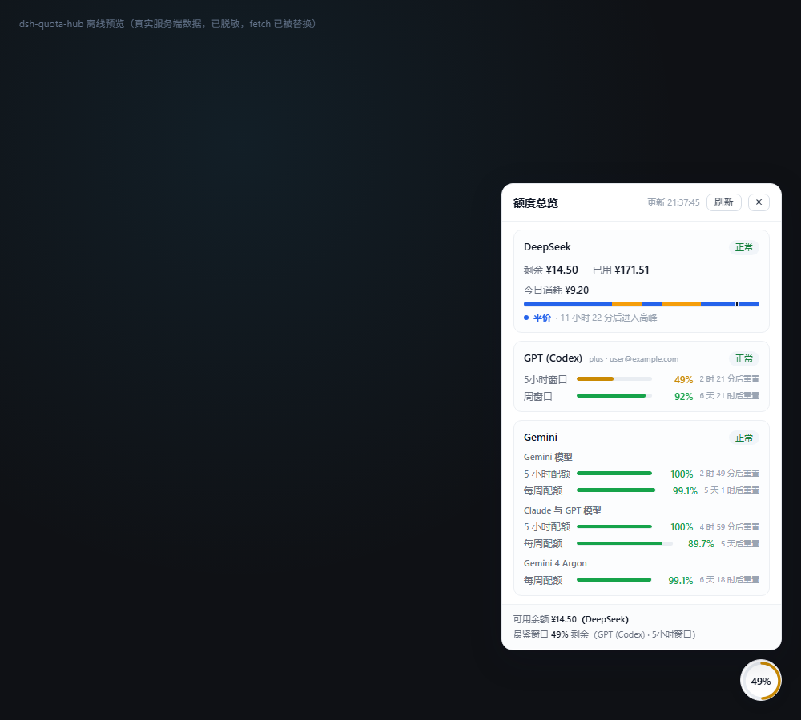

# dsh-quota-ring

[](./LICENSE)


A quota widget for the DSH Web UI. A floating ring opens a card with DeepSeek balances, Codex subscription limits and Antigravity quota groups.

[中文说明](./README.md)



## Features

- The ring shows the lowest remaining percentage among known quota windows.
- DeepSeek shows wallet balance, cumulative spend, estimated daily spend and peak/off-peak timing.
- GPT (Codex) shows the rate windows and reset times reported for the account.
- Gemini shows the quota groups returned by Antigravity. Available groups vary by account and upstream response.
- Providers are queried independently. A failed provider does not hide other results.
- Polling defaults to 10 minutes, with manual refresh, idle back-off and a server cache.

Money and percentage limits are displayed separately. Missing values are not treated as zero or full quota.

## Installation

Requires DSH with the Web UI and `webServer` service, and Node.js 18 or later.

Run in the terminal used for DSH:

```bash
dsh plugin --profile desktop add https://github.com/j352201657-debug/dsh-quota-ring
```

For a separate Web profile, replace `desktop` with `web`. Restart the matching DSH instance after installation.

| Provider | Login requirements |
|---|---|
| DeepSeek | Sign in through DSH's built-in DeepSeek account component |
| GPT (Codex) | Install `dsh-codex-subscription` and sign in |
| Gemini | Install `dsh-agy-cli` and authorize an Antigravity account |

Raw Gemini quotas require Windows Credential Manager. Other platforms use the AGY status fallback, which may omit some windows. Each provider needs a valid login to display its quotas.

To uninstall, remove this plugin's dependency and registration entry from the matching profile, then restart DSH. Statistics remain in `dsh-quota-ring/usage-state.json` under the DSH data directory until removed separately.

## Data and display

| Provider | Source | Unit |
|---|---|---|
| DeepSeek | `platform.deepseek.com/api/v0/users/get_user_summary` | Wallet currency |
| GPT (Codex) | `chatgpt.com/backend-api/wham/usage` | Remaining rate-window percentage |
| Gemini | `daily-cloudcode-pa.googleapis.com/v1internal:retrieveUserQuotaSummary`, falling back to local `/plugins/agy-cli/status` | Remaining quota-group percentage |

These endpoints are not a stable public protocol defined by this plugin. Changes to upstream fields or authentication can break queries. The AGY fallback may contain fewer groups than the raw endpoint.

### Daily spend

Spend is estimated from balance observations: decreases count as spend, increases as top-ups. Records use UTC+8 calendar days, retain 30 days of history and persist across restarts.

Tracking starts with the first observation. A same-day `.dshw-usage.json` record can provide an initial value. The card displays the start time when known.

A top-up and spending between two observations can only be recorded as a net change. This estimate is not an official billing statement.

### Peak/off-peak timing

Built-in reference windows are UTC 01:00–04:00 and 06:00–10:00, corresponding to 09:00–12:00 and 14:00–18:00 in Beijing. Weekends and the built-in 2026 holiday table affect the calculation.

Windows and holiday dates are configurable. These hints do not calculate official charges; current platform rules and bills take precedence.

## Configuration

Settings belong in this plugin's `config` entry in the matching profile.

| Field | Default | Purpose |
|---|---|---|
| `refreshIntervalMs` | `600000` | Client polling interval in ms; minimum 5000 |
| `idleMultiplier` | `3` | Interval multiplier while unfocused |
| `pauseWhenHidden` | `false` | Pause polling when the page is hidden |
| `dshHome` | `''` | DSH data directory; empty enables discovery |
| `dshWebPort` | `0` | AGY status port; 0 infers it from the request Host |
| `proxy` | `''` | HTTP or HTTPS proxy; empty enables discovery |
| `serverCacheTtlMs` | `60000` | Server cache duration in ms; 0 disables caching |
| `requestTimeoutMs` | `15000` | Timeout per upstream request in ms |
| `corsOrigins` | Loopback origins | CORS allow-list; loopback hosts also accept any port |
| `deepseekPeakWindows` | `null` | UTC peak windows, e.g. `[{start:1,end:4},{start:6,end:10}]` |
| `deepseekPeakHolidays` | `null` | UTC+8 holiday dates, e.g. `['2026-10-01']` |

Credential directories are checked in this order:

1. `config.dshHome`.
2. `DSH_HOME` and `DSH_DATA_DIR` environment variables.
3. Ancestor directories of the installed plugin.
4. `.dsh` in the user's home directory.

Proxy discovery checks configuration, `HTTPS_PROXY` / `HTTP_PROXY` / `ALL_PROXY` environment variables, then Windows system proxy settings. Requests are direct if no proxy is found. Loopback requests are always direct.

Concurrent quota queries share an in-flight request. Manual refresh bypasses the completed-result cache but reuses an ongoing query. Credentials are read again for each new upstream query, including after login or account changes.

## HTTP API

The route prefix is `/api/quota-hub`. Access follows the DSH host's authentication and network settings.

| Method | Path | Purpose |
|---|---|---|
| GET | `/summary` | Aggregated quotas with caching |
| GET | `/summary?force=1` | Bypass the completed-result cache |
| POST | `/refresh` | Manual refresh |
| GET | `/config` | Display settings; exposes only whether a proxy is configured |
| GET | `/diag` | Local diagnostics without upstream quota requests |

Quota responses contain `providers`, `fetchedAt` and `health`. Provider status is `ok`, `missing_key`, `unavailable` or `error`. Detail fields include `windows` and, for Gemini, optional `groups`. DeepSeek also returns `peak` and `usage`.

The diagnostic details are under `diag` and include credential file paths, parsing results, dependency versions and suggested actions. Inspect diagnostics before sharing: they can contain local paths.

## Storage and privacy

- DeepSeek and Codex credentials are read from local `.credentials.yaml`.
- Gemini access tokens are read from Windows Credential Manager. This plugin does not write or renew credentials; querying the AGY status endpoint can trigger AGY's own renewal logic.
- Quota queries require network access to the services above and any configured proxy. The DeepSeek request origin also follows the credential's `issuer` field.
- Daily-spend estimates are saved in local `usage-state.json`. Generating a preview saves a quota snapshot.
- The project has no telemetry reporting logic. Dynamic widget text is written with `textContent`.

## Development and tests

The server uses CommonJS; the client uses plain DOM. No build step is required.

```bash
npm test
node --check client.js
node --check index.js
```

`npm test` runs offline regression tests using temporary directories and local test servers. It does not read real credentials or call provider quota APIs. Failures return a nonzero exit code.

To generate a preview with local account data:

```bash
node preview/build-preview.cjs
```

Open the generated `preview/preview.html`. This command queries real quotas and updates local daily-spend statistics. The preview uses a static snapshot. Inspect generated files before publishing; masking is not a substitute for review.

Source layout:

- `index.js`: routes and host lifecycle.
- `client.js`: ring, card and refresh interactions.
- `src/aggregator.js`: in-flight requests, cache and provider isolation.
- `src/adapters/`: provider requests and response parsing.
- `src/credentials.js` and `src/keyring.js`: credential readers.
- `src/http.js`: HTTP, proxies, timeouts and response parsing.
- `src/peak.js` and `src/usage.js`: timing hints and spend estimates.
- `tests/`: offline regression tests.

## Troubleshooting

| Symptom | Check |
|---|---|
| Ring is missing | Installation profile, registration entry and DSH startup logs |
| Not signed in | Provider login and parsing results in `/diag` |
| Old login state remains | Refresh and confirm that the DSH login component saved new credentials |
| Gemini is unavailable | AGY authorization, plugin state and DSH Web port |
| Some Gemini windows are missing | Whether the AGY status fallback is in use |
| Requests time out | Network and `proxy` configuration |
| Peak/off-peak hints are outdated | Window and holiday settings |

Set `QH_DEBUG=1` for server debug logs. Check logs for account information and local paths before sharing.

## License

[MIT](./LICENSE)
