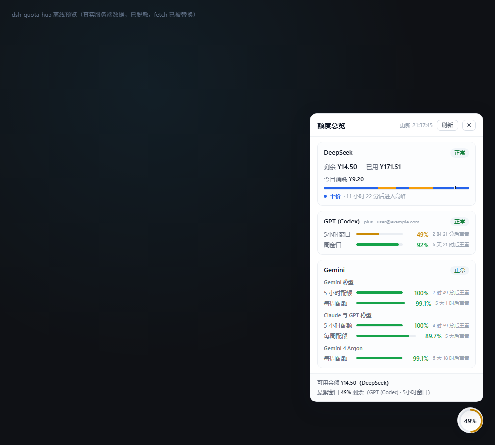

# dsh-quota-ring

[](./LICENSE)


**把 DeepSeek、GPT (Codex)、Gemini 三家账号的额度，收进 DSH 右下角的一个圆环里。**

圆环上的环形进度条直接显示「最紧的那个额度窗口还剩多少」，点开是三家卡片：剩余、已用、重置倒计时、DeepSeek 峰谷时段与今日消耗。默认 10 分钟轮询一次，做了防抖与失焦降频；某一家凭据过期或请求失败时只影响它自己那一行，另外两家照常渲染。



<sub>离线预览渲染的真实数据（`preview/build-preview.cjs` 生成，不重启 DSH 即可查看）。</sub>

---

## 目录

- [为什么需要它](#为什么需要它)
- [特性](#特性)
- [安装](#安装)
- [界面说明](#界面说明)
- [额度是怎么拿到的](#额度是怎么拿到的)
- [配置参数](#配置参数)
- [HTTP API](#http-api)
- [轮询与请求保护](#轮询与请求保护)
- [降级与错误状态](#降级与错误状态)
- [隐私与安全](#隐私与安全)
- [目录结构](#目录结构)
- [开发与自测](#开发与自测)
- [发布到插件市场](#发布到插件市场)
- [已知限制](#已知限制)
- [排障：装上去没数据怎么办](#排障装上去没数据怎么办)
- [实现踩坑记录（改代码前必读）](#实现踩坑记录改代码前必读)
- [变更记录](#变更记录)
- [License](#license)

---

## 为什么需要它

在 DSH 里，这三家的额度来源完全不同，而且**都不是「填一个 API Key 去查余额」**：

| | 额度挂在哪 | 额度是什么 |
|---|---|---|
| DeepSeek | DSH 账号登录（`.credentials.yaml` 里的 grant token） | **真金额**，CNY/USD |
| GPT (Codex) | Codex 订阅插件的 OAuth 登录态 | **百分比速率窗口**（5 小时 + 每周） |
| Gemini | Antigravity CLI 的登录态（Windows 凭据管理器） | **百分比速率窗口**（三个额度池 × 每周/5 小时） |

所以要看到它们，得分别打开 DSH 设置里的账号页、Codex 订阅面板、Antigravity 的「查看用量」——三处，三个口径。这个插件把三条链路直接读出来，用同一张卡片呈现，并**保持三者语义互不混淆**（详见[语义诚实性](#语义诚实性)）。

> 和 `dsh-cost-meter`（费用统计插件）的关系：那个插件管**花了多少钱**，这个插件管**还剩多少额度**。两者的侧栏组件确实有重叠——本插件装好后，可以在 `设置 → 费用 → 显示 → 侧栏` 关闭费用插件的余额/今日/Codex 额度/峰谷条，让信息只出现一处。

## 特性

- **右下角悬浮圆环**：环形进度 = 所有百分比窗口中「剩余最少」的一个；中心数字随之变化，无百分比时显示 `¥`（有金额）或 `!`（有错误）。点击展开/折叠卡片。
- **三家一并呈现**：DeepSeek 剩余/已用/今日消耗/峰谷时段条；GPT 两个速率窗口；Gemini 三个额度池共五个窗口，各自带重置倒计时。
- **DeepSeek 峰谷时段条**：一天切成 15 分钟片段画成橙（高峰）/蓝（平价）时间条，深色竖线标出此刻，配文「平价 · 11 小时 53 分后进入高峰」。
- **DeepSeek 今日消耗**：官方没给按天数据，插件按余额差自己记账，能识别中途充值，跨重启延续，跨天归档。
- **单家降级**：三家并发、各自超时、各自兜底；一家挂了不影响另外两家。
- **三重请求保护**：服务端 60 秒缓存 + 手动 600ms 防抖/3 秒限流 + 失焦降频或暂停。
- **只读、不联网外传**：仅读取本机 DSH 凭据，只向 DeepSeek / ChatGPT / Google 三个官方域名发请求；不落盘密文、不打印密钥、无第三方上报。
- **无前端框架依赖**：客户端是纯 DOM（`client.js` 一个文件），不依赖 React / react-dom，避免宿主版本差异。

## 安装

### 前置条件：这台机器上必须有什么

插件本身不挑机器，也不依赖 API Key；它读的是 **DSH 里的登录态**。所以「另一个人的电脑上」需要具备下面这些，缺谁就只缺那一行：

| 需要的东西 | 提供什么 | 缺了会怎样 |
|---|---|---|
| **DSH 桌面版**（含 Web UI 与 `webServer` 服务） | 插件宿主、`/api/quota-hub/*` 路由、`window.__ModuleLoader__` | 插件不会加载 |
| **`dsh-codex-subscription`** 并已登录 | GPT (Codex) 的 OAuth 凭据（记录名 `codex-subscription/accounts`） | GPT 那一行显示「未登录」 |
| **`dsh-agy-cli`** 并在终端执行过一次 `agy` 登录 | Gemini 的额度（Windows 凭据管理器 `gemini:antigravity` + `/plugins/agy-cli/status`） | Gemini 那一行显示「不可用」 |
| DeepSeek 账号登录态（DSH 内置 `dsh-deepseek-account-platform`） | 余额与累计消费（记录名 `deepseek-account-platform/default`） | DeepSeek 那一行显示「未登录」 |
| Node.js ≥ 18 | 插件运行时（无第三方依赖） | 服务端不启动 |

> **一句话**：**Codex 与 Gemini 用的就是这两个插件**（`dsh-codex-subscription`、`dsh-agy-cli`）——把它们也装到对方机器上、登录好，本插件就能取到数；这两个插件名或它们的凭据记录名若不同，需要在 `src/credentials.js` / `src/adapters/agy.js` 里改对应的读取路径（见[目录结构](#目录结构)的分层说明）。
> DeepSeek 走的是 DSH 自带实现，不用另外装。

### 换一台电脑要注意什么（插件已处理的部分）

| 事项 | 插件怎么处理 |
|---|---|
| DSH 数据目录不叫 `D:\DSHData\.dsh` | 留空 `dshHome` 即可：依次试 环境变量 `DSH_HOME` / `DSH_DATA_DIR` → **从插件自身安装路径逐级上溯找 `.credentials.yaml`** → `D:\DSHData\.dsh` → `~/.dsh` |
| Web 端口每次重启都变 | 不写死：从请求 `Host` 头推断（`dshWebPort: 0`） |
| 用户名 / 家目录不同 | 全程用 `os.homedir()` 与相对路径，无绝对路径、无用户名 |
| Windows 代理配置不同或不走代理 | `proxy` 留空时依次试 环境变量 → 注册表 → 直连；也可显式填 |
| DSH 版本改了记录名 | 记录名匹配失败时，会模糊匹配「名字里带 deepseek / codex 且含 token / access 的记录」 |
| 就是跑不起来 | 打开 **`/api/quota-hub/diag`** 自检（见下） |

### 装完先看自检

```powershell
# 换成你当前的 DSH Web 地址（端口每次重启会变，从浏览器地址栏复制）
Invoke-RestMethod http://127.0.0.1:<port>/api/quota-hub/diag | ConvertTo-Json -Depth 6
```

返回里直接回答四个问题：凭据文件找到没有（`credentialsFile` / `triedHomes`）、两家的账号记录解析出来没有（`deepseek.ok` / `codex.ok` + 过期与否）、两个依赖插件装没装（`plugins[].installed` + 版本）、当前平台有哪些能力降级（`runtime.note`）。最后 `tips` 是给人看的下一步动作。

它**不发起任何网络请求**，也不回显任何密文（只报「有 / 没有」）。

### 安装步骤

```powershell
# 1) 复制插件到 profile 的 node_modules
$profile = "D:\DSHData\.dsh\profiles\desktop"   # 换成你的 profile 路径
# 目标目录名必须与 package.json 的 name 一致（dsh-quota-ring），否则 cordis 解析不到
Copy-Item -Recurse -Force .\dsh-quota-ring "$profile\node_modules\dsh-quota-ring"
```

2) 在 `$profile/package.json` 的 `dependencies` 里加一行：

```json
"dsh-quota-ring": "file:./node_modules/dsh-quota-ring"
```

3) 在 `$profile/cordis.patch.yml` 末尾追加（本包 `cordis.patch.yml` 的内容）：

```yaml
- insert:
    - id: quota-hub
      name: 'dsh-quota-ring'
      config:
        refreshIntervalMs: 600000
        idleMultiplier: 3
        pauseWhenHidden: false
        dshHome: ''
        dshWebPort: 0
        proxy: ''
        serverCacheTtlMs: 60000
        requestTimeoutMs: 15000
        corsOrigins:
          - 'http://127.0.0.1'
          - 'http://localhost'
        deepseekPeakWindows: null
        deepseekPeakHolidays: null
```

4) **重启 DSH**（客户端 bundle 只在启动时加载）。

重启后右下角出现圆环。首次加载约 2~5 秒（三家并发，Gemini 首次要读凭据管理器并建 TLS 连接），之后走 60 秒缓存。

> 配置项**写全**是有意的：`cordis.patch.yml` 的覆盖不是深合并，漏写的字段会被抹成默认值之外的 `undefined`（本插件内部仍会归一化兜底，但写全更省事）。

### 卸载

删掉 `$profile/node_modules/dsh-quota-ring`、`package.json` 里那一行、`cordis.patch.yml` 里那个 `- insert:` 块，重启 DSH。

## 界面说明

**圆环**

- 固定右下角 24px，直径 52px，SVG 环形进度条。
- 环形长度 = 所有百分比窗口里**剩余最少**的那个。
- 颜色分档：`>60%` 绿 `#16a34a` / `≤60%` 黄 `#ca8a04` / `≤30%` 橙 `#ea580c` / `≤10%` 红 `#dc2626` / 未知 灰。
- 中心数字 = 该百分比；无百分比数据时显示 `¥`（有金额）或 `!`（有错误）。

**卡片**

| 平台 | 内容 |
|---|---|
| DeepSeek | 剩余 / 已用（真金额）→ 今日消耗 → 峰谷时间条（橙=高峰、蓝=平价、深色竖线=此刻）+「平价 · 11 小时 53 分后进入高峰」 |
| GPT (Codex) | 5 小时窗口、周窗口：进度条 + 剩余% + 「N 小时 M 分后重置」 |
| Gemini | 三个额度池分组（Gemini 模型 / Claude 与 GPT 模型 / Gemini 4 Argon），每组 5 小时与每周窗口各占一行 |
| 底部总览 | 「可用余额 ¥15.03（DeepSeek）」「最紧窗口 49% 剩余（GPT (Codex) · 5小时窗口）」——两条独立结论 |

**界面约定**

- **白底黑字**：`#ffffff` 底 / `#111827` 主文案 / `#6b7280` 次文案 / `#e9edf2` 进度条底 / `#eef1f4` 分隔线；强调色取 600 档（`#16a34a` / `#ca8a04` / `#ea580c` / `#dc2626`），因为浅底上 400 档的翠绿与柠檬黄几乎不可读。
- **不显示解释性文字**：上游返回的大段英文说明、`数据源：…`、`登录态剩余约…` 这类内部信息不上界面；`provider.notes` 里只有以 `⚠` 开头的告警会渲染。卡片是仪表盘，不是日志面板。

## 额度是怎么拿到的

| 平台 | DSH 内置实现 | 本插件如何取数 | 额度形态 |
|---|---|---|---|
| **DeepSeek** | `dsh-deepseek-account-platform` | 读 `.credentials.yaml` 里的 grant token，直接请求<br>`GET https://platform.deepseek.com/api/v0/users/get_user_summary`<br>头：`x-dsh-auth-token: <token>` | **真金额**（CNY/USD）<br>有剩余 + 有已用 |
| **GPT** | `dsh-codex-subscription` | 读 `.credentials.yaml` 里的 OAuth access token，请求<br>`GET https://chatgpt.com/backend-api/wham/usage`<br>头：`authorization: Bearer <access>` + `chatgpt-account-id` | **百分比速率窗口**<br>5 小时 + 每周 |
| **Gemini** | `dsh-agy-cli`（驱动 Antigravity CLI） | **首选**读 Windows 凭据管理器 `gemini:antigravity` 的只读令牌，直接<br>`POST https://daily-cloudcode-pa.googleapis.com/v1internal:retrieveUserQuotaSummary`<br>失败才回退 `GET http://127.0.0.1:<DSH端口>/plugins/agy-cli/status` | **百分比速率窗口**<br>三个额度池、五个窗口 |

**为什么直接打官方接口，而不是问 DSH 要**：DSH 自己没有统一的额度查询入口，三家的额度分散在三个内置实现的私有 RPC 里；直接请求它们请求的同一批端点，语义最准、依赖最少，也不受 DSH 内部 RPC 协议变更影响。

### Gemini：为什么「5 小时窗口」总是未知

Antigravity 的真实额度是**三个 group、五个 bucket**：

| 额度池 | 每周 | 5 小时 |
|---|---|---|
| Gemini 模型（Gemini Flash / Pro） | `gemini-weekly` | `gemini-5h` |
| Claude 与 GPT 模型 | `3p-weekly` | `3p-5h` |
| Gemini 4 Argon | `gemini-argon-wtu-weekly` | （无） |

`dsh-agy-cli` 把它们**压平**成 `google` / `anthropic` / `openai` 三个 family 再暴露，而它的循环写法是「后出现的 group 覆盖前面的」：`Gemini 4 Argon` 只有周额度，覆盖掉 `Gemini Models` 的 `gemini-5h`，于是 `/status` 里 `google.fiveHourUnknown` 恒为 `true`。

**额度本身一直都在，是数据在传递过程中被丢了。** 所以本插件直接读原始接口，按 group 原样渲染；只有在拿不到令牌 / 令牌过期 / 接口失败时才回退到压平数据，并在附注里明确写「额度数据来自 agy-cli 状态接口（已压平，可能缺少部分窗口）」。

### DeepSeek 峰谷时段

官方是**峰谷分时计价**：

| 项 | 规则 |
|---|---|
| 峰时段 | **UTC** `01:00–04:00`、`06:00–10:00` = **北京时间 09:00–12:00、14:00–18:00** |
| 周末 | 北京时间周六、周日全天按平价 |
| 节假日 | 中国公众假期全天平价（内置 2026 年安排，可用配置覆盖） |
| 优先级 | 周末 / 节假日**优先**于峰窗口 |
| 生效起点 | `2026-08-16T16:00:00Z` 之前无峰谷之分 |

卡片上把当日 00:00–24:00 切成 15 分钟片段再合并同相位，画成一条时间条，深色竖线是当前时刻。

### DeepSeek 今日消耗

DeepSeek **没有**「今天花了多少」的官方字段，只有当前余额和累计消费。所以插件自己按天记账：

```
今日消耗 = 今日起始余额 + 今日充值 − 当前余额
```

- 每次拿到余额就与上一次比较：**减少**记为消耗、**增加**记为充值（中途充值不会把消耗算成负数）。
- 状态存在 `$DSH_HOME/dsh-quota-ring/usage-state.json`，重启后接着算；跨天自动归档，保留 30 天。
- 首次安装时，若 DSH 自己的 `.dshw-usage.json` 有当天记录，就用它作为起点，避免一装上就显示 ¥0。
- 记账起点不是当天零点时，界面会标明「（自 20:11 起）」，不假装是全天数据。

### 语义诚实性

三家额度**语义不同**，插件绝不混淆：

- DeepSeek 是**钱**：剩余 17.02 CNY、累计消费 168.98 CNY。
- GPT / Gemini 是**百分比速率窗口**：剩 60%、98.59%，到点重置。

所以底部总览给的是两条**独立结论**，而不是一个假的合计数：

```
可用余额 ¥15.03（DeepSeek）
最紧窗口 49% 剩余（GPT (Codex) · 5小时窗口）
```

**不做汇率折算** —— 把「剩 60%」折算成美元是伪精度。v1 里的 `conversion` 配置项因此被删除。

### 窗口「未知」不代表 100%

上游没上报某个窗口时（Gemini 的 `fiveHourUnknown`、或某个 bucket 标了 `disabled`），插件显示**「未知」**配灰色空进度条，**绝不填 1.0（100%）**——否则一个已耗尽的账号会显示「100% 剩余」，属于危险误导。

## 配置参数

写在 profile `cordis.patch.yml` 里本插件的 `config` 下。

| 字段 | 类型 | 默认 | 说明 |
|---|---|---|---|
| `refreshIntervalMs` | number | `600000` | 客户端轮询周期（毫秒）。最小 5000，非法值回退默认 |
| `idleMultiplier` | number | `3` | 失焦降频倍数。失焦时周期 = `refreshIntervalMs × idleMultiplier` |
| `pauseWhenHidden` | boolean | `false` | `true` = 页面隐藏时暂停轮询（恢复可见立即刷一次）；`false` = 仅降频 |
| `dshHome` | string | `''` | DSH 用户数据目录（含 `.credentials.yaml`）。留空自动探测 |
| `dshWebPort` | number | `0` | DSH Web 端口，用于访问 agy-cli。`0` = 从请求 Host 头推断（**推荐**，端口每次重启都可能变） |
| `proxy` | string | `''` | 代理地址，如 `http://127.0.0.1:12450`。留空自动探测 |
| `serverCacheTtlMs` | number | `60000` | 服务端聚合缓存 TTL（毫秒）。`0` = 关闭缓存 |
| `requestTimeoutMs` | number | `15000` | 单家请求超时（毫秒）。只影响该家 |
| `corsOrigins` | string[] | `['http://127.0.0.1','http://localhost']` | CORS 白名单（回环地址任意端口另外无条件放行） |
| `deepseekPeakWindows` | array \| null | `null` | 峰时段覆盖（UTC 小时，半开区间 `[start,end)`）。`null` = `[{start:1,end:4},{start:6,end:10}]` |
| `deepseekPeakHolidays` | string[] \| null | `null` | 中国公众假期覆盖（如 `'2026-10-01'`）。`null` = 内置 2026 年安排，跨年后建议补表 |

### 凭据目录探测顺序（`dshHome` 留空时）

1. 环境变量 `DSH_HOME`
2. 环境变量 `DSH_DATA_DIR`
3. `D:\DSHData\.dsh`（DSH 桌面版默认位置）
4. `~/.dsh`

取第一个存在 `.credentials.yaml` 的目录。**插件只读不写，绝不打印密文。**

### 代理探测顺序（`proxy` 留空时）

1. `config.proxy`
2. 环境变量 `HTTPS_PROXY` / `https_proxy` / `HTTP_PROXY` / `http_proxy` / `ALL_PROXY` / `all_proxy`
3. Windows 注册表 `HKCU\Software\Microsoft\Windows\CurrentVersion\Internet Settings` 的 `ProxyServer`（含 `http=host:port;https=host:port` 形态）
4. 直连

> **为什么必须自己实现代理**：Node 的 `http`/`https` **既不读 Windows 系统代理，也不自动使用 `HTTP(S)_PROXY` 环境变量**。实测 `chatgpt.com` 与 `platform.deepseek.com` 直连会一直挂到超时，走 `127.0.0.1:12450` 的 CONNECT 隧道则 1~4 秒正常返回。回环地址（`127.0.0.1`/`localhost`/`::1`）一律直连。

## HTTP API

注册方式：`webServer.register({ kind: 'prefix', path: '/api/quota-hub' })`。

| 方法 | 路径 | 说明 |
|---|---|---|
| `GET` | `/api/quota-hub/summary` | 聚合三家额度（命中服务端缓存时直接返回） |
| `GET` | `/api/quota-hub/summary?force=1` | 绕过缓存重新拉取（手动刷新） |
| `GET` | `/api/quota-hub/config` | 脱敏配置（不含任何密文，只返回 `proxyConfigured: boolean`） |
| `POST` | `/api/quota-hub/refresh` | 等价于 `summary?force=1` |
| `GET` | `/api/quota-hub/diag` | 自检：凭据文件路径、账号记录是否解析成功、依赖插件版本、平台降级项。**不联网、不回显密文** |

### `GET /summary` 响应

```jsonc
{
  "ok": true,
  "fetchedAt": 1793894402000,
  "health": { "ok": 3, "total": 3 },
  "providers": [
    {
      "id": "deepseek",
      "label": "DeepSeek",
      "status": "ok",                  // ok | unavailable | error | missing_key
      "kind": "money",                 // money | percent
      "plan": null,
      "account": null,
      "remaining": 17.02,              // money：金额；percent：最紧窗口剩余百分比
      "used": 168.98,
      "unit": "CNY",                   // 金额型是币种；百分比型是 "%"
      "windows": [],                   // 金额型为空数组
      "notes": ["累计消费 168.98 CNY"],
      "message": "",                   // 失败/降级时的中文说明
      "fetchedAt": 1793894402000,
      "ms": 313,                       // 本次上游耗时
      "peak":  { /* 见下 */ },
      "usage": { /* 见下 */ }
    },
    {
      "id": "codex",
      "label": "GPT (Codex)",
      "status": "ok",
      "kind": "percent",
      "plan": "plus",
      "account": "someone@example.com",
      "remaining": 60,
      "used": 40,
      "unit": "%",
      "windows": [
        { "label": "5小时窗口", "remainingPercent": 60, "usedPercent": 40,
          "resetsAt": 1793894402000, "windowSeconds": 18000, "unknown": false },
        { "label": "周窗口", "remainingPercent": 94, "usedPercent": 6,
          "resetsAt": 1794481202000, "windowSeconds": 604800, "unknown": false }
      ],
      "notes": ["计划：plus"],
      "message": "",
      "ms": 1372
    },
    {
      "id": "agy",
      "label": "Gemini",
      "kind": "percent",
      "status": "ok",
      "remaining": 89.67,
      "used": 10.33,
      "unit": "%",
      "windows": [ /* 五个窗口摊平后的并集，供总览计算 */ ],
      "groups": [
        { "label": "Gemini 模型",
          "windows": [
            { "label": "5 小时配额", "remainingPercent": 99.94, "resetsAt": 1793924862000, "windowSeconds": 18000, "unknown": false },
            { "label": "每周配额",   "remainingPercent": 99.11, "resetsAt": 1794324635000, "windowSeconds": 604800, "unknown": false }
          ] },
        { "label": "Claude 与 GPT 模型",
          "windows": [
            { "label": "5 小时配额", "remainingPercent": 100 },
            { "label": "每周配额",   "remainingPercent": 89.67 }
          ] },
        { "label": "Gemini 4 Argon",
          "windows": [{ "label": "每周配额", "remainingPercent": 98.27 }] }
      ],
      "notes": ["数据源：Antigravity 原始额度接口"]
    }
  ]
}
```

### DeepSeek 额外的两个字段

```jsonc
{
  "id": "deepseek",
  "kind": "money",
  "remaining": 15.82, "used": 170.19, "unit": "CNY",

  // 峰谷时段
  "peak": {
    "phase": "offPeak",          // 'peak' | 'offPeak'
    "reason": "window",          // 'window' | 'weekend' | 'holiday' | 'preRule'
    "nextAtMs": 1793926800000,   // 下一次相位切换（北京时间 09:00）
    "nextPhase": "peak",
    "dayStartMs": 1793865600000, // 当日 00:00（北京时间）
    "dayEndMs": 1793952000000,
    "nowMs": 1793923239000,
    "segments": [                // 当日 0–1 比例的峰/谷分段，供画时间条
      { "phase": "offPeak", "from": 0,     "to": 0.375 },
      { "phase": "peak",    "from": 0.375, "to": 0.5   }
    ]
  },

  // 今日消耗（插件自己按天记账）
  "usage": {
    "today": 8.01,
    "currency": "CNY",
    "sinceMs": null,             // 非 null 时界面标注「（自 HH:MM 起）」
    "credits": 9.45,             // 今日识别到的充值
    "source": "dsh-usage",       // 'dsh-usage' 种子 | 'self' 自行记账 | 'none'
    "history": [{ "date": "2026-11-05", "amount": 8.01 }]
  }
}
```

## 轮询与请求保护

| 机制 | 实现 |
|---|---|
| **服务端缓存** | `serverCacheTtlMs = 60000`，60 秒内的重复请求直接返回上一次结果 |
| **手动防抖** | 600ms 防抖（连点只发一次）+ 3000ms 最小间隔（跨点击限流） |
| **失焦降频** | `visibilitychange` / `blur` → 周期 × `idleMultiplier`（或按 `pauseWhenHidden` 暂停）；`focus` / 可见 → **立即刷新一次**并恢复周期 |

**并发与隔离**

```js
Promise.allSettled(adapters.map(a => a.fetch(credentials, config, runtime)))
```

- 三家**并发**，总耗时 ≈ 最慢那家，而不是三家之和。
- 每家内部把异常转成结构化 `status: 'error'`；`allSettled` 再兜一层，防「适配器意外 throw」。
- **单家失败只影响自己那一条**，另外两家照常渲染。

## 降级与错误状态

| `status` | 含义 | 界面表现 |
|---|---|---|
| `ok` | 正常 | 剩余 / 已用 / 重置倒计时 |
| `missing_key` | 未登录该平台（凭据里没有对应记录） | 灰徽标「未登录」+ 缺失原因 |
| `unavailable` | 上游存在但该能力不可用（未装 agy-cli、账号不上报窗口） | 黄徽标 + 说明 |
| `error` | 请求失败 / 凭据过期 / 被拒绝 | 红徽标 + 可操作的中文提示 |

错误提示都回答「怎么办」：

- `账号凭据已失效，请在 DSH 设置 → 账号里重新登录 DeepSeek`
- `登录凭据已过期，请在 DSH 的 Codex 订阅插件里重新登录`
- `Gemini 登录已过期，请在终端执行一次 agy 重新登录`
- `请求超时（chatgpt.com 通常需要代理，请检查 proxy 配置）`
- `未检测到 dsh-agy-cli 插件（Gemini 额度由它提供），可先安装/启用该插件`
- `连接本机 <port> 端口被拒绝，且原始额度接口也不可用；请确认 DSH Web 服务端口`

## 隐私与安全

- **只读凭据**：只读 `.credentials.yaml` 与 Windows 凭据管理器；不写回、不刷新令牌、不落盘、不打印。
- **只连三个官方域名**：`platform.deepseek.com`、`chatgpt.com`、`daily-cloudcode-pa.googleapis.com`，加上本机 `127.0.0.1` 的 agy-cli 状态接口。没有遥测、没有第三方上报。
- **`/config` 脱敏**：任何 API 都不会回显密文，代理地址只返回布尔值 `proxyConfigured`。
- **CORS 收紧**：默认只放行回环地址；`isOriginAllowed` 对回环 host 放行任意端口，其余按 `corsOrigins` 白名单。
- **前端不拼 HTML**：所有动态文本用 `textContent` 写入，避免上游返回内容造成 XSS。

## 目录结构

```
dsh-quota-ring/
├── package.json              # 插件清单：main / exports / dsh.bundle.patch / dsh.client
├── cordis.patch.yml          # 注册补丁：把本插件 insert 进 profile 的插件列表
├── index.js                  # 服务端入口：/api/quota-hub/* 路由（CommonJS）
├── client.js                 # 客户端入口：圆环 + 卡片 + 峰谷条（纯 DOM，无 React）
├── src/
│   ├── config.js             # 默认配置 / 归一化（深合并 + 数值兜底）/ 脱敏
│   ├── credentials.js        # 读 .credentials.yaml：DeepSeek grant + Codex OAuth
│   ├── keyring.js            # 只读 Windows 凭据管理器（gemini:antigravity）
│   ├── http.js               # GET/POST + CONNECT 代理隧道 + 系统代理探测
│   ├── shape.js              # 三家统一返回结构 + 时间/百分比归一
│   ├── peak.js               # DeepSeek 峰谷判定（UTC 窗口 + 周末/节假日 + 分段）
│   ├── usage.js              # DeepSeek 今日消耗记账（余额差 + 充值识别）
│   ├── aggregator.js         # 并发聚合 + TTL 缓存 + 单家失败隔离
│   ├── diag.js               # 自检：凭据定位、记录解析、依赖插件探测（GET /diag）
│   ├── log.js                # 调试日志开关（QH_DEBUG=1）
│   └── adapters/
│       ├── index.js          # 适配器注册表（顺序 = 界面顺序）
│       ├── deepseek.js       # 金额型：get_user_summary + 峰谷 + 今日消耗
│       ├── codex.js          # 百分比型：chatgpt.com wham/usage
│       └── agy.js            # 百分比型：antigravity 原始额度池（回退 agy-cli /status）
├── preview/                  # 离线预览（开发辅助，不参与运行时）
│   ├── build-preview.cjs     # 用真实数据生成预览页
│   ├── preview.html          # 桩掉 fetch / __ModuleLoader__ 的渲染页
│   └── card-final.png        # 截图
├── selftest-v3.cjs           # 峰谷 / 今日消耗记账的自测脚本
├── README.md
└── LICENSE
```

**分层原则**：`index.js` 只管 HTTP 协议与生命周期；`aggregator.js` 只管调度与缓存；`adapters/*` 只管一家上游的取数与解析；`peak.js` / `usage.js` 是 DeepSeek 专用的两个纯计算模块；`credentials.js` 是**唯一**知道「凭据存在哪」的地方；`diag.js` 只读不联网；`client.js` 只管渲染与交互。

**换插件/换上游只改一处**：GPT 与 Gemini 的取数分别集中在 `adapters/codex.js`、`adapters/agy.js`，它们的**凭据定位**都在 `credentials.js`。如果对方机器上换成了别的 Codex 插件（记录名不同），只改 `credentials.js` 的 `findCodexBlock`；换了别的 Gemini 插件，只改 `adapters/agy.js`。其余层不用动。

**新增第四家平台**只需写一个 `adapters/xxx.js`（导出 `{ id, label, fetch(credentials, config, runtime) }`，返回 `shape.js` 的统一结构）并加进 `adapters/index.js`，其他层零改动。

## 开发与自测

```powershell
# 语法检查（无构建步骤，源码即产物）
Get-ChildItem -Recurse -Filter *.js | ForEach-Object { node --check $_.FullName }

# 峰谷判定 + 今日消耗记账的自测
node selftest-v3.cjs

# 不重启 DSH 就查看真实数据的渲染结果
node preview/build-preview.cjs            # 生成 preview/preview.html
# 然后用浏览器打开 preview/preview.html
```

`preview.html` 会桩掉 `window.fetch` 与 `window.__ModuleLoader__.load`，直接注入真实 `/summary` 数据，因此**能验证真实的渲染分支，而不需要宿主**。测试用的历史数据、充值、跨天归档都在临时目录里跑，不污染真实的 `usage-state.json`。

## 发布到插件市场

本插件已经可以走 `dsh plugin add`（声明了 `dsh.bundle.patch`，`cordis.patch.yml` 与社区插件同构），但**还不能出现在 DSH 的插件市场 / Plugins → Discover 里**，因为市场有一道白名单：

> Installs are restricted to sources listed in the curated awesome-dsh-plugin registry — anything else is rejected.

市场与 Discover 读的是同一份目录 —— [`awesome-dsh-plugin`](https://github.com/awesome-dsh-plugin/awesome-dsh-plugin)。所以要「一键装」只差两件事：**发到 npm** 和 **进那个列表**。

### 1. 补齐 manifest（发布前必做）

`package.json` 里已有 `engines.dsh`、`publishConfig`，但 `repository` / `author` / `homepage` 得换成你自己的地址（本仓库已填好，fork 后请替换）：

```json
{
  "repository": { "type": "git", "url": "git+https://github.com/j352201657-debug/dsh-quota-ring.git" },
  "homepage": "https://github.com/j352201657-debug/dsh-quota-ring#readme",
  "bugs": { "url": "https://github.com/j352201657-debug/dsh-quota-ring/issues" },
  "author": "Chen Yang Ji"
}
```

### 2. 发布（二选一）

```bash
# A. npm（推荐：市场按 npm 包名 + 已知版本拉取）
npm publish          # 已是 public 包名，publishConfig.access 已设为 public

# B. 只有 GitHub：打 tag + Release，别人用 git 地址装
dsh plugin --profile web add https://github.com/j352201657-debug/dsh-quota-ring
```

### 3. 向 awesome-dsh-plugin 提 PR（加一行）

在 `README.md` 的 `<!-- BEGIN PLUGINS -->` 区、**Usage & Billing** 分类下按字母序插入一行（一行 = 一条记录，描述用英文一句话、写清楚行为）：

```markdown
- [j352201657-debug/dsh-quota-ring](https://github.com/j352201657-debug/dsh-quota-ring) - Floating quota ring in the DSH Web UI for DeepSeek, GPT (Codex) and Gemini accounts: remaining and used amounts, DeepSeek peak/off-peak schedule with today's spend, Gemini's three Antigravity quota pools, plus 10-minute polling with idle backoff.
```

审核看三件事：能 `dsh plugin add` 装上、描述与实际行为一致、分类正确。收录通常一天内生效，之后市场与 Discover 会自动出现，不需要再改本仓库任何代码。

### 现在的临时分发方式

未上架之前，别人可以这样装（等价于本 README「安装」一节的手动步骤）：

```bash
dsh plugin --profile web add https://github.com/j352201657-debug/dsh-quota-ring
# 或本地目录
dsh plugin --profile web add D:\path\to\dsh-quota-ring
```

## 已知限制

- **限额来自上游**：GPT 的 `chatgpt.com/backend-api` 与 Antigravity 的 `daily-cloudcode-pa` 都是非公开接口，上游改结构时插件会退化为 `error` / `unavailable`，不会伪造数据。
- **Gemini 依赖 agy-cli / Antigravity 登录态**：没装 `dsh-agy-cli` 或没登录时该行显示「未登录」。
- **平台能力差异**（不影响另外两家）：

  | 能力 | Windows | macOS / Linux |
  |---|---|---|
  | Gemini 原始额度接口（三池齐全） | 支持（PowerShell + `advapi32!CredRead` 读 `gemini:antigravity`） | 不支持 → 回退 agy-cli `/status`（**5 小时窗口可能显示「未知」**） |
  | 系统代理自动发现 | 读注册表 `Internet Settings` | 只认 `HTTPS_PROXY` / `HTTP_PROXY` 或显式 `proxy` |
  | 其余（DeepSeek / GPT / 峰谷 / 今日消耗） | 支持 | 支持 |
- **DeepSeek 今日消耗是推断值**：基于余额差，不是官方账单；充值当天会被单列为 `credits`，但若在两次轮询之间既充值又消耗，只能按净额记账。
- **峰谷节假日表**：内置 2026 年安排，跨年后用 `deepseekPeakHolidays` 覆盖。
- **DSH Web 端口每次重启可能变化**：默认从请求 Host 头推断，不要写死。

## 排障：装上去没数据怎么办

按顺序查，基本三步内能定位。**第 0 步永远是打开 `/api/quota-hub/diag`**。

| 症状 | 大概率原因 | 动作 |
|---|---|---|
| 右下角没有圆环 | 插件没被加载 | 看 DSH 启动日志里有没有 `dsh-quota-ring`；确认 `cordis.patch.yml` 有 `- insert: [{id: quota-hub, name: 'dsh-quota-ring'}]`；确认改完**重启过** DSH |
| 圆环在、卡片里全是「未登录」 | 本机没有对应登录态 | 看 `/diag` 的 `deepseek.ok` / `codex.ok` 与 `plugins[].installed` |
| GPT 行「未登录」但 Codex 插件已装 | 没登录，或记录名不同 | 去 Codex 订阅插件里登录一次；`/diag` 的 `codex.source` 应为 `records` 或 `refs` |
| GPT 行「请求失败 401」 | OAuth access 过期 | 在 `dsh-codex-subscription` 里重新登录；`/diag` 的 `codex.expired` 会是 `true` |
| Gemini 行「不可用」 | `dsh-agy-cli` 没装 / 端口没推断到 | 装 `dsh-agy-cli` 并在终端执行一次 `agy`；或手动填 `dshWebPort` |
| Gemini 5 小时窗口「未知」 | 回退到了压平后的 `/status` | 看 `/diag` 的 `runtime.keyringAvailable`；非 Windows 属预期（见[已知限制](#已知限制)） |
| 三家都「请求超时」 | 网络必须走代理，且没探测到 | 显式填 `proxy: 'http://127.0.0.1:<port>'`，或在终端 `setx HTTPS_PROXY ...` 后重启 DSH |
| 卡片显示但数字一直是旧的 | 服务端缓存（60 s）或失焦降频 | 点「刷新」；`serverCacheTtlMs` 可调小 |

需要更细的日志时，用环境变量 `QH_DEBUG=1` 启动 DSH，服务端会打印每次上游请求的失败原因（不含密文）。

## 实现踩坑记录（改代码前必读）

1. **DeepSeek token 不能按字符集截取**。token 是 base64 风格，含 `/` 和 `+`。用 `[A-Za-z0-9._-]` 这类字符集会**在第 25 个字符处截断**，服务端返回 `{"code":40003,"msg":"Authorization Failed (invalid token)"}`。必须取「整行冒号后的全部内容」。
2. **Node 不读系统代理**。见[代理探测顺序](#代理探测顺序proxy-留空时)。不实现 CONNECT 隧道，`chatgpt.com` 会挂到超时。
3. **`.credentials.yaml` 的 `records` 是对象不是数组**。`codex-subscription/accounts` 里的 `accounts` 才是列表，且 `credential` 是嵌套对象。
4. **百分比「未知」不能当 100%**。Gemini 的 `fiveHourUnknown: true` 必须显示「未知」。
5. **`credits.balance = '0'` 不是余额**。Codex 订阅额度制下该字段恒为 0，别当钱展示。
6. **`0E-16` 是合法的 0**。DeepSeek 钱包金额会出现科学计数法字符串，`parseFloat('0E-16') === 0`。
7. **`Number(null) === 0` 且是有限值**。做百分比四舍五入时，若只判断 `Number.isFinite`，「未知」窗口会被悄悄变成「0% 剩余」——正好是最危险的误导。`src/shape.js` 的 `round2()` 因此先显式排除 `null` / `undefined` / 空字符串。
8. **agy-cli 的 `/status` 会丢额度组**。三个 group 压平成三个 family，后出现的 `Gemini 4 Argon`（只有周额度）覆盖掉 `Gemini Models` 的 `gemini-5h`，于是 5 小时窗口永远是「未知」。必须直接读 `retrieveUserQuotaSummary` 原始接口。
9. **读原始接口必须带完整 CLI 身份头**。`User-Agent` 太简短时，daily 端点会**整个省略 Gemini group**，只返回第三方组。要带 `antigravity/cli/1.4.2 (aidev_client; os_type=windows; arch=amd64; auth_method=consumer)` 与配对的 `X-Goog-Api-Client`。
10. **令牌轮换导致的 401 要重读一次**。agy-cli 的 `/status` 调用可能顺手触发令牌续期，此时凭据管理器里已换新，而本进程 30 秒缓存里握着**刚失效的旧令牌**，请求必然 401。`src/adapters/agy.js` 因此在 401/403 时强制重读令牌再试，第二次失败才回退。
11. **Windows 凭据读取必须用 `-Command "& { … } <target>"`**。用 `-Command -` 从 stdin 喂 PowerShell 脚本会静默返回空（退出码 0），排查起来极易误判成「没有凭据」。
12. **`.dshw-usage.json` 不可全信**。它是 DSH 自己的日用量账本，可能停止更新，且 `lastBalance` 不包含中途充值。只把它当作首次安装的记账起点。
13. **逐块 `toString('utf8')` 会把中文字符切碎**。通过 CONNECT 隧道手写 HTTP 解析时，响应体必须按 `Buffer` 累积、用 `buf.indexOf('\r\n\r\n')` 找头尾；Gemini 额度响应里的 `description` 带中文，字符串拼接会出乱码。
15. **写死数据目录等于写死机器**。最初用 `D:\\DSHData\\.dsh` 作为默认值，换台电脑（或换 DSH 安装位置）直接找不到凭据。正解：从 `__dirname` 逐级上溯找 `.credentials.yaml` —— 插件装在 `<home>/profiles/<p>/node_modules/` 下，这条路径本身就是线索。
16. **端口兜底值同样是陷阱**。曾用 62943 作为 `FALLBACK_PORT`，而本机端口实际在 62943 → 50428 → 51633 … 之间变化。改为「不知道就不猜」（0 = 跳过依赖端口的接口），因为 Gemini 原始接口根本不经过端口。

14. **端口推断失败不该放弃 Gemini**。读 agy-cli `/status` 需要 DSH Web 端口（每次重启会变），但**原始额度接口只依赖凭据管理器里的令牌**，与端口无关。因此 `/status` 失败时只记一条附注、继续走原始接口；两条路都失败才报错。

## 变更记录

| 版本 | 要点 |
|---|---|
| **3.1.0** | 可移植性收口：数据目录改为「从插件安装路径反推」，去除对 D:\DSHData\.dsh 的硬依赖；移除写死的 62943 端口兜底；凭据记录名支持模糊匹配；新增 GET /diag 自检与 src/diag.js、src/log.js（QH_DEBUG=1）；README 补齐依赖清单、跨机器说明、平台能力矩阵与排障表 |
| **3.0.0** | DeepSeek 峰谷时段条与今日消耗；Gemini 改为按 antigravity 三个额度池渲染（修复 5 小时窗口恒为「未知」）；界面改白底黑字；新增 `peak.js` / `usage.js` / `keyring.js`；`http.js` 支持 POST 与 Buffer 响应体 |
| **2.0.0** | 推翻 v1 的「API Key + 查余额」假设，改读 DSH 账号凭据：DeepSeek 真余额、GPT 与 Gemini 百分比速率窗口；新增 CONNECT 代理隧道；统一 `shape.js` 契约；语义诚实（不做汇率折算） |
| **1.0.0** | 初版：悬浮圆环 + 三家卡片 + 轮询/防抖/降频 + 降级（设计前提有误，见 2.0.0） |

## License

[MIT](./LICENSE)
